# AgriSight AI — Precision Agriculture Weed & Crop Detection Dashboard

AgriSight AI is an intelligent real-time computer vision system and web dashboard designed for precision agriculture. It monitors live video feeds from USB webcams, IP cameras, or field drones to detect, classify, track, and log **cotton crops** and **invasive weeds / grasses**.

In addition to real-time optical detection, AgriSight features a **Hybrid AI Weed Risk Assessment & Recommendation Engine** combining structured agronomic decision rules, verified agricultural research guidance (ICAR, TNAU, PAU, CIB&RC), LangGraph workflow orchestration, and strict safety validation.

---

## Table of Contents

- [Key Features](#key-features)
- [System Architecture](#system-architecture)
- [Hybrid AI Weed Risk Assessment & Recommendation Engine](#hybrid-ai-weed-risk-assessment--recommendation-engine)
- [Project Directory Structure](#project-directory-structure)
- [Requirements](#requirements)
- [Installation & Setup](#installation--setup)
- [Running the Application](#running-the-application)
- [Usage Guide & UI Controls](#usage-guide--ui-controls)
- [API Reference](#api-reference)
- [Model & Vision Pipeline Details](#model--vision-pipeline-details)
- [Retraining & Active Learning](#retraining--active-learning)
- [Automated Testing](#automated-testing)
- [Troubleshooting & FAQs](#troubleshooting--faqs)

---

## Key Features

- **Dual-Model YOLO + CLIP Verification Pipeline**:
  - Uses two complementary Roboflow YOLO models (`cotton-8/3` for weed/grass proposal and `cotton-nwbc7/2` for cotton crop detection).
  - Integrates OpenAI CLIP zero-shot classification to verify cropped bounding boxes against natural-language prompts, rejecting non-plant clutter (bare soil, laptops, blurred frames, clothing, background elements).
- **Hybrid AI Weed Risk Assessment & Farmer Advisor**:
  - Operates downstream of detection: evaluates weed abundance, spatial clustering, inter-crop proximity, and cotton growth stage.
  - Distinguishes **visible weed count**, **ByteTrack unique tracked count**, and **physical density** (with mandatory sensor calibration guardrails).
  - Categorizes risk into `LOW`, `MODERATE`, `HIGH`, and `INSUFFICIENT_DATA`.
  - Assigns actionable priorities: `HIGH PRIORITY`, `MEDIUM PRIORITY`, `ROUTINE MONITORING`, `VERIFICATION REQUIRED`.
- **Verified Agricultural Knowledge Base (ICAR / TNAU / PAU / CIB&RC)**:
  - Grounded in authoritative research from ICAR-Central Institute for Cotton Research (CICR), Directorate of Weed Research (DWR), and State Agricultural Universities.
  - Enforces mandatory safety guidelines for post-emergence directed sprays, wind/weather constraints, and PPE requirements.
  - Transparent citations and publication metadata for every recommendation.
- **Groq LPU Agricultural Reasoning Service**:
  - High-speed, context-aware agronomic advisory powered by Groq's LPU inference engine (`openai/gpt-oss-120b` / `qwen/qwen3.8-27b`).
  - Constrained strictly to verified agricultural knowledge base and deterministic risk calculations.
  - Automatic fallback to deterministic rules if offline or unconfigured.
- **Four-Part Plot Segmentation & Weed Risk Heatmap**:
  - Automatically partitions agricultural plot frames into four spatial quadrants (`Part 01 (NW)`, `Part 02 (NE)`, `Part 03 (SW)`, `Part 04 (SE)`).
  - Continuous Gaussian weed risk heatmap visualization.
  - Per-quadrant weed-to-crop ratio, spatial clustering, and localized treatment recommendations.
- **LangGraph 9-Node Decision Orchestration**:
  - State machine workflow: Input Validation -> Weed Analysis -> Crop Risk -> Missing Info Check -> Knowledge Retrieval -> Treatment Assessment -> Safety Validation -> Farmer-Friendly Guidance (Groq) -> Final Response.
- **Decoupled High-Speed Streaming**:
  - Camera ingestion runs on an independent worker thread targeting up to 30–60 FPS.
  - Cloud inference and recommendation generation run asynchronously without blocking or lagging the live MJPEG camera feed.
- **Hardware Watchdog & Auto-Recovery**:
  - Monitors frame intervals; if the camera driver or video stream stalls for more than 3 seconds (common with DirectShow on Windows or intermittent RTSP links), the watchdog automatically reinitializes the capture device.
- **Persistent Object Tracking & Counting (ByteTrack)**:
  - Tracks individual cotton plants and weeds across successive frames using ByteTrack.
  - Maintains separate counts for **Currently Visible** plants vs. **Total Unique Tracked** plants across the session.
- **Automated Logging, Audit Trail & Action Tracking**:
  - Automatically captures timestamped detection snapshots and writes detection metadata to `logs/detections.csv`.
  - Logs farmer recommendations and recorded field interventions in `recommendation_data/recommendation_history.csv`.
- **Automated Retraining Dataset Collection**:
  - Automatically stores weed-infested frames with normalized YOLO format (`class_id x_center y_center width height`) label files under `weed_samples/`, ready for direct upload and retraining on Roboflow.
- **Responsive In-Browser Dashboard**:
  - Clean, modern dashboard built with HTML5 Canvas overlay, SVG icons, and reactive polling.
  - Embedded interactive **AI Farmer Advisor** section with Field Analysis, "Why This?", and "Record Action" controls.

---

## System Architecture

```mermaid
flowchart TD
    subgraph Capture["Video Ingestion Layer"]
        CAM["Video Source\n(USB Webcam / RTSP / HTTP)"] -->|cv2.VideoCapture| CAPTURE["Capture Thread\n(Independent ~30 FPS)"]
        CAPTURE -->|DirectShow / FFMPEG| MJPEG["MJPEG Video Stream\n(/video_feed)"]
        CAPTURE -.->|Heartbeat Check| WATCHDOG["Driver Watchdog\n(Auto-Reconnect on Stall)"]
    end

    subgraph Inference["Optical AI Vision Pipeline"]
        CAPTURE -->|Downscaled Frame| DISPATCH["Inference Worker Loop"]
        DISPATCH --> YOLO1["Roboflow YOLO\n(cotton-8/3)"]
        DISPATCH --> YOLO2["Roboflow YOLO\n(cotton-nwbc7/2)"]
        YOLO1 & YOLO2 --> DEDUP1["IoU Box Deduplication"]
        DEDUP1 --> CLIP["CLIP Zero-Shot Verification\n(Filter Soil, Artifacts, Clutter)"]
        CLIP --> TRACK["ByteTrack Multi-Object Tracker"]
    end

    subgraph Advisor["Hybrid AI Recommendation Engine (Downstream)"]
        TRACK --> WA["Weed Analyzer\n(Visible vs. Unique Counts, Density)"]
        TRACK --> SA["Spatial Analyzer\n(Clusters, 3x3 Grid, Crop Proximity)"]
        WA & SA --> CR["Crop Risk Engine\n(CPWC Window 15-60 DAS)"]
        CR --> LG["LangGraph Decision Workflow\n(9-Node State Machine)"]
        KB["Agricultural Knowledge Base\n(ICAR / TNAU / CIB&RC)"] --> LG
        LG --> SV["Safety Validator\n(Hoods, Wind <8km/h, CIB&RC Label)"]
    end

    subgraph Output["Output & Persistence Layer"]
        TRACK --> UI["Live Video & Canvas Overlay"]
        SV --> UI_ADV["AI Farmer Advisor UI Section"]
        SV --> REC_STORE["recommendation_data/\n(recommendations.json + CSV)"]
        TRACK --> LOGS["Detection Log\n(logs/detections.csv)"]
        TRACK --> SAMPLES["Retraining Samples\n(weed_samples/images + labels)"]
    end
```



---

## Hybrid AI Weed Risk Assessment & Recommendation Engine

The recommendation engine operates **strictly downstream** of the optical vision pipeline without altering YOLO, CLIP, or ByteTrack execution:

### 1. Weed Analysis Engine (`analysis/weed_analyzer.py`)
- Distinguishes **Visible Weed Count** from **Unique Tracked Count** (ByteTrack) to prevent treating the same plant across multiple frames as new plants.
- Physical density (plants/m²) is **only calculated** when calibrated Ground Sampling Distance (GSD) or surveyed field area is provided; otherwise reported as uncalibrated.
- Computes weed-to-crop ratios and dispersion metrics.

### 2. Spatial Analysis Engine (`analysis/spatial_analyzer.py`)
- Analyzes 2D bounding boxes in the image pixel plane.
- Identifies localized weed patches/clusters and partitions the view into a 3x3 quadrant grid.
- Computes crop-weed proximity and canopy overlap.
- **Explicit Guardrail**: Image coordinates are never fabricated into GPS coordinates.

### 3. Crop Risk Engine (`analysis/crop_risk_engine.py`)
- Grounded in the **Critical Period of Weed Competition (CPWC)** in cotton (15–60 Days After Sowing).
- Categorizes risk into `LOW`, `MODERATE`, `HIGH`, or `INSUFFICIENT_DATA`.
- Configurable thresholds with documented requirements for expert agronomist validation. Never fabricates yield loss percentages.

### 4. Agricultural Knowledge Base (`recommendation/knowledge_base.py`)
- Curated repository of verified extension guidance from ICAR-CICR (Nagpur), ICAR-DWR (Jabalpur), TNAU (Coimbatore), and PAU (Ludhiana).
- Categorized into cultural, mechanical, manual, and chemical practices with full citations and publication years.

### 5. Hybrid Recommendation Engine (`recommendation/recommendation_engine.py`)
- Assigns action priorities:
  - **`HIGH PRIORITY`**: Immediate inspection warranted; act within 24–48 hours during CPWC.
  - **`MEDIUM PRIORITY`**: Localized management planned according to crop stage and field conditions.
  - **`ROUTINE MONITORING`**: Continued weekly scouting protocol (every 5–7 days).
  - **`VERIFICATION REQUIRED`**: Unclear optical data or missing critical crop stage.
- **Safety Validation Layer**:
  - Enforces mandatory hooded/shielded directed spraying between rows for any post-emergence chemical option.
  - Enforces wind constraints (<8 km/h) and minimum rain-free period (4–6 hours).
  - Prohibits dosage prescriptions without official registered CIB&RC product labels.

### 6. LangGraph Workflow Orchestration (`recommendation/graph.py` & `recommendation/farmer_advisor.py`)
- 9-Node StateGraph: Input Validation -> Weed Analysis -> Crop Risk -> Missing Info Check -> Knowledge Retrieval -> Treatment Assessment -> Safety Validation -> Farmer Explanation -> Final Response.
- Includes deterministic pure-Python fallback execution engine.
- Signature-based recommendation caching to eliminate duplicate requests on static frames.

---

## Project Directory Structure

```text
weed_detection-main/
│
├── .venv/                          # Python virtual environment
├── requirements.txt                # Python dependencies
├── README.md                       # Complete documentation
│
└── weed_detection-main/
    ├── app.py                      # Flask server, VisionEngine, UI & API routes
    │
    ├── analysis/                   # Weed & spatial analysis modules
    │   ├── __init__.py
    │   ├── weed_analyzer.py        # Counts, density caveats, dispersion
    │   ├── spatial_analyzer.py     # Image clusters, 3x3 grid, proximity
    │   └── crop_risk_engine.py     # CPWC risk modeling (LOW/MOD/HIGH/INSUFFICIENT)
    │
    ├── recommendation/             # Hybrid AI recommendation engine
    │   ├── __init__.py
    │   ├── knowledge_base.py       # Verified ICAR/TNAU/PAU guidance & citations
    │   ├── recommendation_engine.py# Decision rules, action priorities, safety validator
    │   ├── graph.py                # 9-node LangGraph StateGraph workflow
    │   ├── farmer_advisor.py       # Advisor agent, caching, agronomic Q&A
    │   └── recommendation_service.py # Async worker pool & audit logging service
    │
    ├── recommendation_data/        # Recommendation storage & audit trails
    │   ├── recommendations.json    # Structured assessment history
    │   ├── recommendation_history.csv # Audit trail with farmer action records
    │   └── knowledge_sources.json  # Verified source citations index
    │
    ├── tests/                      # Automated test suite (14 unit/integration tests)
    │   ├── __init__.py
    │   ├── test_all_modules.py     # Engine unit tests
    │   └── test_api_integration.py # Flask API integration tests
    │
    ├── logs/                       # Optical detection logs
    │   └── detections.csv          # Frame detection history
    ├── snapshots/                  # Annotated JPEG frame captures
    └── weed_samples/               # Active learning dataset (YOLO format)
        ├── classes.txt             # Class mapping (0: cotton, 1: grass)
        ├── images/                 # Raw frames containing detected weeds
        └── labels/                 # Normalized YOLO bounding-box labels (.txt)
```

---

## Requirements

- **Operating System**: Windows 10/11, macOS, or Linux
- **Python**: Version **3.10**, **3.11**, or **3.12**
- **Camera**: USB webcam or network IP/RTSP camera stream (`rtsp://`, `http://`)
- **Dependencies**: `flask`, `opencv-python`, `numpy`, `inference-sdk`, `supervision<0.24.0`, `langgraph`, `langchain-core`

---

## Installation & Setup

### 1. Open Terminal or PowerShell
Navigate to the project root directory:
```bash
cd "path/to/weed_detection-main"
```

### 2. Create and Activate Virtual Environment
**On Windows (PowerShell):**
```powershell
python -m venv .venv
.\.venv\Scripts\Activate.ps1
```

**On Linux / macOS:**
```bash
python3 -m venv .venv
source .venv/bin/activate
```

### 3. Install Dependencies
```bash
pip install -r requirements.txt
```

> [!IMPORTANT]
> **Supervision Version Requirement**: This application uses `supervision.ByteTrack`. `supervision` must be `<0.24.0` (such as `supervision==0.23.0`). Installing `supervision>=0.24.0` will result in `AttributeError: module 'supervision' has no attribute 'ByteTrack'`. The `requirements.txt` file is pinned to a tested release.

---

## Running the Application

### 1. Launch the Server
```bash
cd weed_detection-main
python app.py
```

### 2. Access the Dashboard
- **Local Machine**: Open [http://127.0.0.1:5000](http://127.0.0.1:5000) in your web browser.
- **Mobile Phone / Field Tablet (Same Wi-Fi)**: Open `http://<YOUR_LAPTOP_IP>:5000`.

---

## Usage Guide & UI Controls

1. **Camera Stream & Controls**:
   - Select **Laptop / USB camera** (click Scan) or **IP camera** (enter RTSP URL).
   - Set resolution (`1280 × 720` recommended) and click **▶ Start live detection**.
2. **Field Map & Weed Risk Section (Area A + Area B)**:
   - **Area A — Interactive Field Map**:
     - Large prominent field visualization with toggleable **Weed Risk Heatmap** (Gaussian spatial density), **Quadrant Dividers**, **Cotton & Weed Overlays**, and **Labels**.
     - High-contrast **Color Legend**: Green (Low, 0–25%), Yellow (Moderate, 25–50%), Orange (Elevated, 50–75%), Red (High, ≥75%), Gray (Insufficient Data).
     - Interactive Click: Click directly on the map canvas or 2x2 sector cards to inspect Part 01 (NW), Part 02 (NE), Part 03 (SW), or Part 04 (SE).
     - Reset View: Return to Whole Field view with a single click.
     - Mode Detection: Automatically reports `Mode A: Image-Based Field Map` (relative pixel coordinates) or `Mode B: Georeferenced Field Map` (when surveyed area / GPS metadata is provided).
   - **Area B — Region-Specific Farmer Advisor**:
     - Dynamically updates to show the selected region's risk badge, visible cotton and weed counts, observed weed pressure, and spatial proximity.
     - **Main Agronomic Concern**: Explicitly flags localized weed concentration or crop competition.
     - **Recommended Next Step**: Focal action card with agronomic evidence.
     - **Integrated Weed Management (IWM) Options**: Expandable practices (mechanical, manual, cultural, chemical stewardship).
     - **Verified Citations**: Expandable ICAR / TNAU / PAU / CIB&RC research citations.
     - **Historical Field Survey Comparison**: Automatically compares current survey against previous observations for the field (delta weed count, % change, hotspot migration, and logged interventions).
   - **Field-Level Comparison Table**: Foldable table breaking down all 4 quadrants side-by-side with whole-field totals.

---

## API Reference

### Existing Vision & Camera Endpoints (Preserved 100%)
| Method | Endpoint | Description |
|---|---|---|
| `GET` | `/` | Serves dashboard web application |
| `GET` | `/video_feed` | Multipart MJPEG camera video stream |
| `GET` | `/api/cameras` | Scans available USB video capture devices |
| `POST` | `/api/models` | Connects/verifies Roboflow model IDs |
| `POST` | `/api/settings` | Updates confidence, frame size, and API rate limits |
| `POST` | `/api/start` | Starts camera capture and AI processing threads |
| `POST` | `/api/stop` | Stops camera stream and releases hardware |
| `GET` | `/api/status` | Real-time status (FPS, bounding boxes, plant counts) |
| `POST` | `/api/snapshot` | Captures manual snapshot and logs row |
| `GET` | `/api/logs` | Returns recent optical detection log entries (JSON) |
| `GET` | `/api/logs.csv` | Downloads optical detection CSV log |
| `GET` | `/snapshots/<file>` | Serves annotated snapshot images |

### Field Map & Weed Risk Intelligence Endpoints
| Method | Endpoint | Description |
|---|---|---|
| `POST` | `/api/field-map/analyze` | Evaluates field image, computes Gaussian heatmap, 4 quadrants, and region advisor recommendations |
| `POST` | `/api/plot/analyze` | Core 4-quadrant segmentation and weed risk analysis |
| `POST` | `/api/plot/demo` | Generates realistic synthetic agricultural plot with all 4 quadrants for testing |
| `GET` | `/api/plot/latest` | Returns latest available field plot analysis |
| `GET` | `/api/plot/analysis/<analysis_id>` | Returns specific plot analysis by ID |
| `GET` | `/api/plot/export/<analysis_id>?format=csv\|json` | Exports full 4-quadrant and whole-field report as CSV or JSON |
| `GET` | `/api/plot/image/<analysis_id>/<img_type>` | Serves `original`, `annotated`, `heatmap`, `NW`, `NE`, `SW`, or `SE` plot images |

### Hybrid AI Recommendation Endpoints (Preserved 100%)
| Method | Endpoint | Description |
|---|---|---|
| `POST` | `/api/recommendations/analyze` | Evaluates detection bounding boxes and generates structured farmer guidance |
| `GET` | `/api/recommendations/latest` | Returns latest available field assessment |
| `GET` | `/api/recommendations/history` | Returns historical recommendations log |
| `GET` | `/api/recommendations/status` | Returns operational health status of recommendation service |
| `POST` | `/api/recommendations/action` | Records an implemented farmer management action |
| `GET` | `/api/recommendations/export` | Downloads `recommendation_history.csv` |
| `POST` | `/api/recommendations/ask` | Answers agronomic questions within verified knowledge base |

---

## Automated Testing

The project includes an automated test suite verifying all analysis modules, safety rules, LangGraph workflows, and Flask endpoints:

```bash
# Run all automated tests
python -m unittest discover tests
```

Expected output:
```text
..............
----------------------------------------------------------------------
Ran 14 tests in 0.156s

OK
```

---

## Troubleshooting & FAQs

### 1. "Camera preview is inactive" or "Could not open this camera"
- Ensure no other application (e.g., Zoom, Teams, Camera app) is holding the webcam lock.
- If using an IP camera, verify the RTSP/HTTP URL is accessible via VLC Player or curl.

### 2. `AttributeError: module 'supervision' has no attribute 'ByteTrack'`
- Run `pip install "supervision<0.24.0"` to install a compatible version.

### 3. Recommendation Service Status is "NOT_ANALYZED_YET"
- Click **🔍 Analyze Field** on the dashboard or trigger `POST /api/recommendations/analyze` to generate the initial assessment.

---

## License

This project is licensed under the Apache License 2.0.
